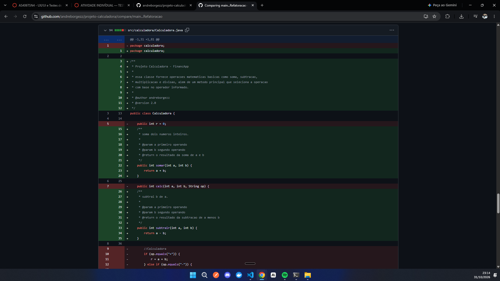
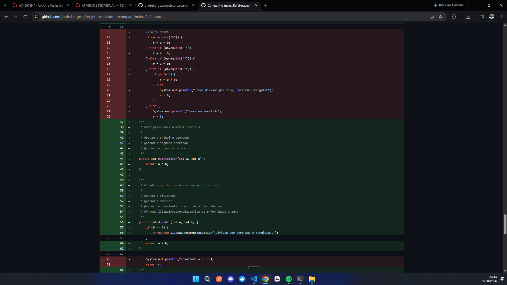
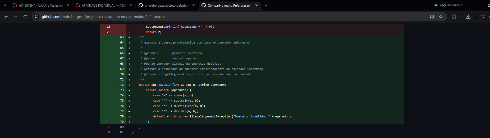
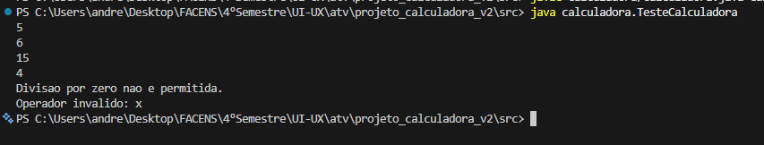
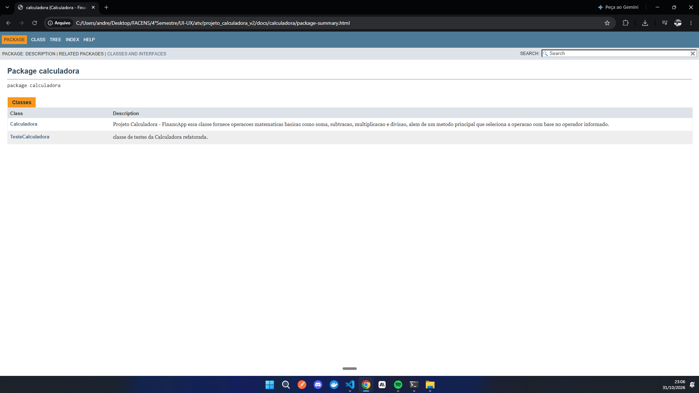

# Projeto Calculadora — FinancApp

> Projeto academico desenvolvido com foco em Qualidade de Software, Testes, Refatoracao, Documentacao e Versionamento.

---

## 1. Identificacao do Projeto

**Projeto:** Projeto Calculadora  
**Contexto:** FinancApp  
**Aluno:** Andre Borges  
**RA:** 250898  
**Curso:** Analise e Desenvolvimento de Sistemas  
**Disciplina:** UI-UX e Testes de Software  
**Professor:** Daniel Ohata  
**Semestre:** 2026.2  

---

## 2. Visao Geral

O projeto consiste no desenvolvimento de um modulo de calculos matematicos basicos em Java para a startup ficticia **FinancApp**.

O modulo foi desenvolvido com o objetivo de ser utilizado futuramente em funcionalidades de controle financeiro, como:

- orcamento mensal;
- divisao de despesas;
- projecoes financeiras;
- calculos auxiliares.

Alem do funcionamento correto das operacoes, o projeto aplica praticas de qualidade de software relacionadas a:

- testes;
- tratamento de erros;
- refatoracao;
- documentacao;
- versionamento;
- manutencao de codigo.

---

## 3. Problema

Durante o desenvolvimento da aplicacao FinancApp, foi identificada a necessidade de criar um modulo matematico reutilizavel.

Entretanto, a equipe definiu que o modulo nao deveria apenas funcionar corretamente, mas tambem apresentar:

- codigo legivel;
- testes automatizados;
- tratamento de falhas;
- documentacao tecnica;
- controle de versoes;
- facilidade de manutencao.

O desafio consiste, portanto, em desenvolver uma solucao funcional e ao mesmo tempo aplicar boas praticas de Engenharia de Software.

---

## 4. Objetivo

### 4.1 Objetivo Geral

Desenvolver uma calculadora em Java aplicando praticas de qualidade, testes, documentacao, refatoracao e versionamento.

### 4.2 Objetivos Tecnicos

- implementar operacoes matematicas basicas;
- tratar entradas invalidas;
- impedir divisao por zero;
- desenvolver testes automatizados;
- refatorar o codigo sem alterar seu comportamento;
- documentar classes e metodos com JavaDoc;
- gerar documentacao HTML;
- utilizar Git e GitHub;
- organizar commits e branches;
- manter documentacao tecnica no README.

---

## 5. Escopo Funcional

| ID | Funcionalidade | Descricao | Status |
|---|---|---|---|
| RF01 | Soma | Soma dois numeros inteiros | OK |
| RF02 | Subtracao | Subtrai dois numeros inteiros | OK |
| RF03 | Multiplicacao | Multiplica dois numeros inteiros | OK |
| RF04 | Divisao | Divide dois numeros inteiros | OK |
| RF05 | Validacao de divisao | Impede divisao por zero | OK |
| RF06 | Operacao invalida | Trata operadores nao suportados | OK |

---

## 6. Requisitos Nao Funcionais

| ID | Categoria | Requisito |
|---|---|---|
| RNF01 | Qualidade | O codigo deve possuir organizacao e legibilidade |
| RNF02 | Testabilidade | As operacoes devem possuir testes automatizados |
| RNF03 | Manutencao | O codigo deve permitir refatoracao sem alteracao funcional |
| RNF04 | Documentacao | Classes e metodos devem possuir JavaDoc |
| RNF05 | Versionamento | O projeto deve utilizar Git e GitHub |
| RNF06 | Confiabilidade | Erros nao devem interromper inesperadamente a execucao |

---

## 7. Tecnologias Utilizadas

| Tecnologia | Versao | Utilizacao |
|---|---|---|
| Java | 21 | Desenvolvimento |
| JDK | 21 | Compilacao |
| Git | 2.x | Controle de versao |
| GitHub | - | Repositorio remoto |
| JavaDoc | - | Documentacao |

---

## 8. Estrutura do Projeto

```
projeto_calculadora/
|
+-- src/
|   +-- calculadora/
|       +-- Calculadora.java
|       +-- TesteCalculadora.java
|
+-- docs/
|   +-- index.html
|
+-- images/
|   +-- testes/
|   +-- javadoc/
|   +-- refatoracao/
|
+-- README.md
+-- .gitignore
```

---

## 9. Branches e Versionamento

O projeto utiliza duas branches:

| Branch | Conteudo |
|---|---|
| main | Versao original da calculadora com if/else if e atributo r |
| Refatoracao | Versao refatorada com metodos separados, switch expression e excecoes |

### Historico de commits

| # | Branch | Mensagem |
|---|---|---|
| 1 | main | criando estrutura do projeto e pacote calculadora |
| 2 | main | adicionando classe Calculadora com as 4 operacoes basicas |
| 3 | main | adicionando classe de testes da calculadora |
| 4 | Refatoracao | refatorando a calculadora com metodos separados e excecoes |
| 5 | Refatoracao | atualizando os testes para usar try catch com as excecoes |
| 6 | Refatoracao | adicionando documentacao javadoc nas duas classes |

---

## 10. Refatoracao

A refatoracao transformou um unico metodo calc() com if/else if em metodos separados por responsabilidade.

**Antes (main):**
- Um metodo calc(int a, int b, String op) com if/else if
- Atributo r para armazenar o resultado
- Erros tratados com System.out.println

**Depois (Refatoracao):**
- Metodos somar, subtrair, multiplicar, dividir separados
- Metodo calcular com switch expression
- Erros tratados com IllegalArgumentException
- Sem efeitos colaterais (sem atributo de estado)

### Evidencia visual







---

## 11. Testes

Os testes sao executados manualmente via metodo main da classe TesteCalculadora.

| Cenario | Entrada | Saida esperada |
|---|---|---|
| Soma | 2 + 3 | 5 |
| Subtracao | 10 - 4 | 6 |
| Multiplicacao | 3 * 5 | 15 |
| Divisao | 8 / 2 | 4 |
| Divisao por zero | 8 / 0 | Divisao por zero nao e permitida. |
| Operador invalido | 5 x 5 | Operador invalido: x |

### Evidencia visual



---

## 12. Documentacao JavaDoc

A documentacao foi gerada com o comando javadoc e esta disponivel na pasta docs/.

### Evidencia visual


